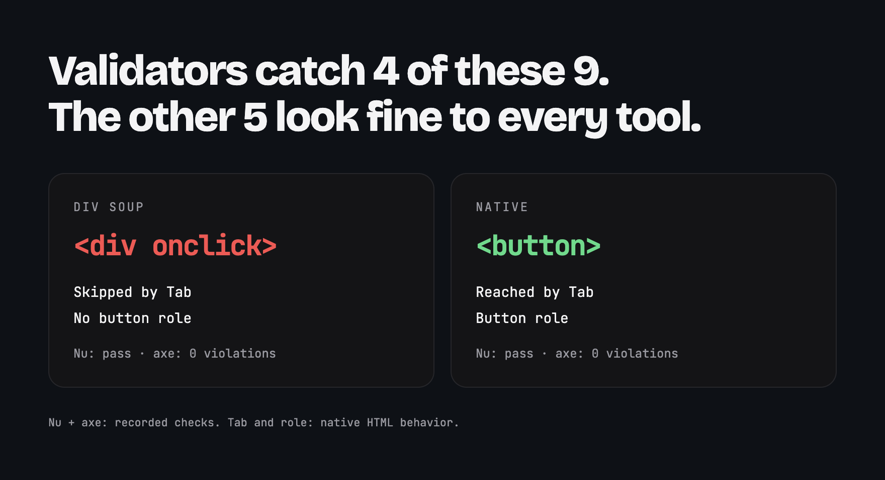
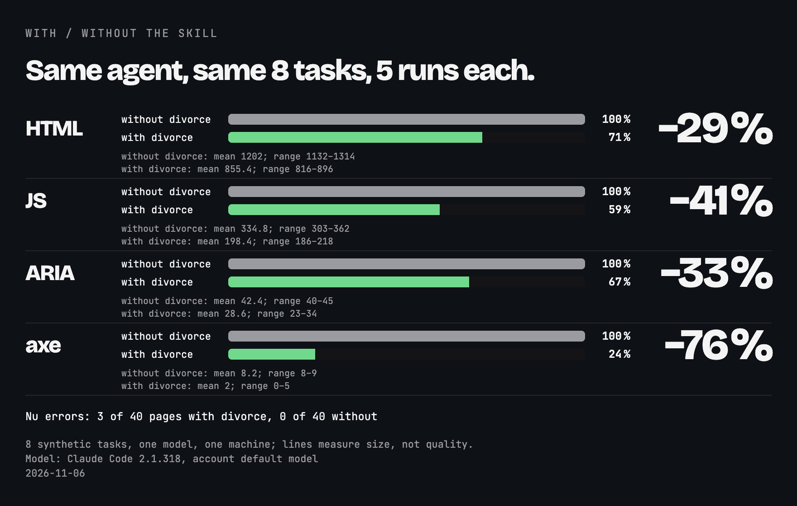
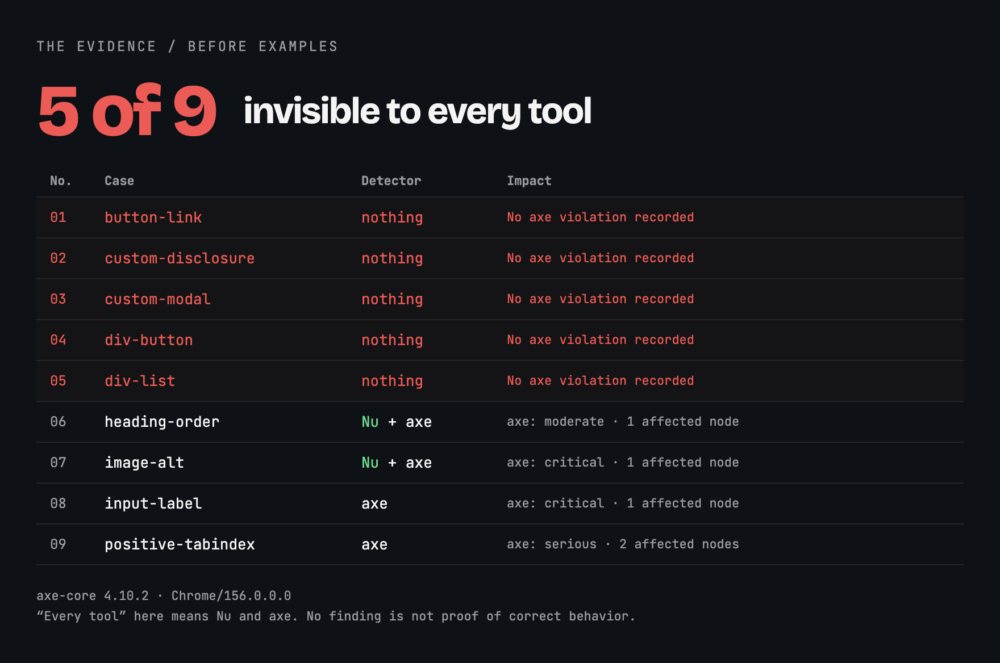
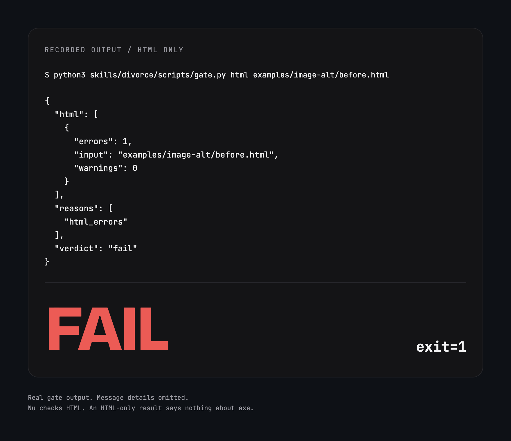

<p align="center"></p>

<h1 align="center">divorce</h1>
<p align="center"><em>End your agent's toxic relationship with div soup.</em><br>A skill for Claude Code and Codex: native HTML first, then proof.</p>

<p align="center"></p>

<p align="center"></p>

## Install

```text
/plugin marketplace add ElRaxy/divorce
/plugin install divorce@divorce
```

<sub>For other installation routes, see <a href="#details">Details</a>.</sub>

## Numbers

<p align="center"></p>

<p align="center"><sub>See the <a href="evals/README.md">with/without evaluation</a> for the measurements and limits.</sub></p>

## The evidence

<p align="center"></p>

<p align="center"><sub><a href="examples/manifest.json">Case file</a> · <a href="examples/axe-measured.json">Measured axe results</a>: findings and the gate policy determine the ruling.</sub></p>

## The ruling

<p align="center"></p>

<p align="center"><sub><a href="assets/data/gate-real.json">Recorded output</a>: Nu checks HTML, axe checks the rendered DOM, and missing evidence means <code>not_measured</code>, never a pass.</sub></p>

## How it works

1. Does it need to exist? If not, omit it.
2. Does the project already have it? Reuse it.
3. Is there a native HTML element for it? Use it.
4. Can CSS do it without JavaScript?
5. Does an installed dependency cover it?
6. Only then: the smallest code that works, plus a small test for logic.

## Details

<details>
<summary>All agents, installation routes and gate commands</summary>

<h3>Install</h3>

Use the plugin commands above in Claude Code, or run one standalone route from an existing checkout's root; validator setup is separate.

| Route | Command | Destination or effect |
| --- | --- | --- |
| Claude, user-wide | `sh install.sh --claude` | Copies the skill and scripts to `~/.claude/skills/divorce/`, recording the installation. |
| Claude, one project | `sh install.sh --claude --project DIR` | Copies to `DIR/.claude/skills/divorce/`. |
| Codex | `sh install.sh --codex` | Copies to `~/.codex/skills/divorce/`; `--project` is Claude-only. |
| Other agents | `sh install.sh --agents-md AGENTS.md` | Appends or replaces a marked block in the instruction file. |

For a manual copy, copy the entire `skills/divorce/` directory, including scripts, to `~/.claude/skills/divorce/`. Instruction blocks point to the gate's absolute path: keep the checkout in place. The standalone installer does not register a plugin, install validators or add an automatic gate hook; copies do not update themselves ([maintenance](docs/faq.md#does-installing-it-make-the-gate-run-itself)).

With the served version of `examples/div-button/after.html` already loaded in your verification browser session:

```sh
python3 skills/divorce/scripts/gate.py html examples/div-button/after.html
agent-browser eval "$(python3 skills/divorce/scripts/gate.py axe-snippet)" > axe.json
python3 skills/divorce/scripts/gate.py axe axe.json
python3 skills/divorce/scripts/gate.py check --html examples/div-button/after.html --axe axe.json --axe-max-impact serious
```

Replace the HTML input with your served URL or built file and capture genuine axe evidence from that same page and state. Outside the checkout, use the installed script path. The gate does not open a browser, run axe or refresh a capture; see [all commands and flags](docs/how-it-works.md#commands).

<h3>FAQ</h3>

Coverage, frameworks and maintenance

A passing gate is not full WCAG conformance, a CSS or JavaScript correctness check, a performance audit or a design review. Manual keyboard, focus, interaction and visual checks remain necessary; accessibility, boundary validation and data-loss handling stay in scope.

- [Frameworks and served HTML](docs/faq.md#can-react-vue-wordpresselementor-and-php-keep-the-house): React, Vue, WordPress/Elementor and PHP.
- [Spec versus convention](docs/faq.md#spec-or-convention-who-gets-the-cursor): cite the spec and preserve project conventions.
- [Benchmark](evals/README.md): five runs; model grading is separate from HTML and axe measurements.
- [Full FAQ](docs/faq.md) · [Skill and element table](skills/divorce/SKILL.md#2-pick-the-element-by-what-it-does) · [Contributing](CONTRIBUTING.md) · [Changelog](CHANGELOG.md).

<h3>Exit codes</h3>

What the verdict covers

| Exit | JSON verdict | Meaning |
| --- | --- | --- |
| 0 | `pass` | The invoked check passed its configured policy. |
| 1 | `fail` | HTML errors or axe violations at or above the impact threshold. |
| 2 | `not_measured` | Missing tools, unavailable input or unusable evidence; never a pass. |

Missing or invalid measurement takes priority over observed failures. Otherwise, blocking findings fail; with neither condition, the check passes. Serious and critical axe violations fail by default; lower impacts remain visible. HTML warnings do not fail. axe totals count violated rules and each rule records affected nodes.

A complete gate needs HTML and axe evidence; an HTML-only pass says nothing about axe. The caller supplies evidence for the intended page: the gate does not authenticate it or prove it is current ([exact reasons and limits](docs/how-it-works.md)).

<h3>Requirements</h3>

Runtime and validator setup

- Python 3.9+ for the standalone installer; Python 3 for the gate; a shell for installation scripts.
- Nu HTML Checker: `VNU`, `vnu` on `PATH`, or `VNU_JAR` with Java.
- Nu setup needs network access, `curl`, and `shasum` or `sha1sum`; native archives also need `unzip`, while `--jar` needs Java.
- A rendered page and a way to evaluate the axe snippet; it loads axe-core 4.10.2 unless that version is already present, so script loading must be allowed.

```sh
sh skills/divorce/scripts/install-vnu.sh
```

The installer verifies the download's SHA-1 and the validator's version command. Set `VNU` to its printed binary path or add `vnu` to `PATH`; for `--jar`, set `VNU_JAR` to the printed JAR path. The axe snippet selects WCAG 2.2 A/AA, including earlier versions, and best-practice rules.
</details>

<!-- Star History: star-history.com cannot read a private repo and renders a broken image. Uncomment when the repo goes public.
## Star History

<a href="https://star-history.com/#ElRaxy/divorce&Date"><picture><source media="(prefers-color-scheme: dark)" srcset="https://api.star-history.com/svg?repos=ElRaxy/divorce&amp;type=Date&amp;theme=dark"></picture></a>
-->

## License

[MIT](LICENSE); see [NOTICE](NOTICE) for third-party licenses: the decision ladder is adapted from [ponytail](https://github.com/DietrichGebert/ponytail) (MIT), semantic HTML and modern CSS guidance from [kemiljk/skills](https://github.com/kemiljk/skills) (MIT); Nu is MIT and axe-core is MPL-2.0, and neither validator is bundled.
