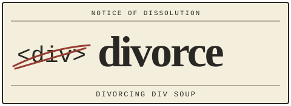

<p align="center"><picture>
  <source media="(prefers-color-scheme: dark)" srcset="assets/logo-dark.svg">
  
</picture></p>
<h1 align="center">divorce</h1>
<p align="center"><em>Your agent is in a toxic relationship with &lt;div&gt;. It's not you, it's the spec.</em></p>
<p align="center">
  <a href="LICENSE"></a>
  
  
  
  
</p>
<p align="center"><picture>
  <source media="(prefers-color-scheme: dark)" srcset="assets/hero.svg">
  
</picture></p>

```bash
/plugin marketplace add ElRaxy/divorce
/plugin install divorce@divorce
```

Run these in Claude Code. [Codex and other installation routes](#install) are below; validator setup is separate.

A skill for web developers using Claude Code and Codex. It guides the smallest native HTML/CSS/JS/ARIA solution against web standards, then checks served HTML with Nu HTML Checker and the rendered DOM with axe-core. Exit **0: pass · 1: fail · 2: not measured**. Missing evidence never counts as a pass.

| Without divorce | With divorce |
| --- | --- |
| A generic container gets every job. | Native elements chosen by behavior. |
| More code before checking what exists. | Reuse the project; try HTML and CSS first. |
| “Looks fine” is the verdict. | Validator evidence, JSON reasons and exit codes. |
| Missing evidence leaves room for a guess. | `not_measured` blocks a pass. |

## How it works

1. 📝 **File the case.** Check whether the feature is needed and whether the project already has it.
2. ⚖️ **Apply the spec.** Choose native elements and CSS before adding JavaScript; preserve safeguards.
3. 🔎 **Read the ruling.** Run Nu and collect axe evidence. Code decides the verdict; check keyboard, focus and visuals separately.

## What it does

**Before writing:** stop at the first adequate solution in the ladder.

1. Is it needed? If not, omit it.
2. Does the project already have it? Reuse it.
3. Is there a native element for it?
4. Can CSS do it without JavaScript?
5. Does an installed dependency cover it?
6. Only then, write the minimum that works. Add a small test for logic.

Pick elements by their behavior:

| Behavior | Element |
| --- | --- |
| Perform an action | `<button type="button">` |
| Navigate | `<a href>` |
| Disclose related content | `<details>` / `<summary>` |
| Open a temporary task on top | `<dialog>` or the Popover API |
| Collect input | Native controls in `<form>`, each with a `<label>` |

ARIA refines native semantics. Accessibility, boundary validation and handling errors that could lose data stay in place. The [skill](skills/divorce/SKILL.md) also guides CSS, state styling and the distinction between specifications and conventions.

**Before finishing:** Nu checks served HTML. axe-core checks the rendered DOM using WCAG 2.2 A/AA tags, including earlier WCAG versions, plus best-practice rules. The gate reads their evidence and applies a fixed policy. Serious and critical axe violations fail by default.

## What it is not

It is not a component library, a CSS validator, a JavaScript correctness check, a performance audit or a design review. It does not prove full WCAG conformance. Manual keyboard, focus and visual checks remain necessary. The gate cannot enforce every decision in the writing ladder.

## A 30-second before / after

Start with [heading-order](examples/heading-order/before.html). An `<h3>` follows an `<h1>`. The [fix](examples/heading-order/after.html) changes it to `<h2>`.

Real `gate.py` output with Nu HTML Checker 26.11.4 is shown below. The before input is displayed as a relative path; the original capture used a machine-local file URL.

```sh
python3 skills/divorce/scripts/gate.py html examples/heading-order/before.html
```

<details><summary>Before: Nu HTML Checker — exit 1</summary>

```json
{"html": [{"input": "examples/heading-order/before.html", "errors": 1, "warnings": 0, "messages": [{"type": "error", "message": "The heading “h3” (with computed level 3) follows the heading “h1” (with computed level 1), skipping 1 heading level.", "line": 10, "column": 6, "extract": "de</h1>\n  <h3>Delive"}]}], "verdict": "fail", "reasons": ["html_errors"]}
```
</details>

```sh
python3 skills/divorce/scripts/gate.py html examples/heading-order/after.html
```

<details><summary>After: Nu HTML Checker — exit 0</summary>

```json
{"html": [{"input": "examples/heading-order/after.html", "errors": 0, "warnings": 0, "messages": []}], "verdict": "pass", "reasons": []}
```
</details>

The second example saves a draft and displays its status. These lines come from [before.html](examples/div-button/before.html) and [after.html](examples/div-button/after.html).

Before:

```html
<div onclick="document.getElementById('result').textContent = 'Saved'">Save</div>
```

After:

```html
<button type="button" onclick="document.getElementById('result').textContent = 'Saved'">Save</button>
```

The HTML validator passes both documents. Their difference appears in accessibility checks with axe and manual keyboard tests. The button supplies native semantics and keyboard activation; the plain div does not. Automated checks do not reliably infer that this div should be a button.

Actual `gate.py` output with the fake `vnu` in [test_gate.py](tests/test_gate.py), selected through `VNU`, is shown below in compact form. The fake returns no messages for these files. This checks the output contract, not HTML validity.

```sh
python3 skills/divorce/scripts/gate.py html examples/div-button/before.html
```

<details><summary>Before: simulated validator — exit 0</summary>

```json
{"html": [{"input": "examples/div-button/before.html", "errors": 0, "warnings": 0, "messages": []}], "verdict": "pass", "reasons": []}
```
</details>

```sh
python3 skills/divorce/scripts/gate.py html examples/div-button/after.html
```

<details><summary>After: simulated validator — exit 0</summary>

```json
{"html": [{"input": "examples/div-button/after.html", "errors": 0, "warnings": 0, "messages": []}], "verdict": "pass", "reasons": []}
```
</details>

No axe, keyboard or visual check was run for this demonstration. No axe output is claimed. See the [example notes](examples/README.md).

## Install

Choose one route. Shell commands below run from the root of an existing divorce checkout.

**Claude Code plugin:** use the two commands at the top. Names come from the [plugin manifest](.claude-plugin/plugin.json) and [marketplace manifest](.claude-plugin/marketplace.json). Validator setup is separate.

| Route | Command | Destination or effect |
| --- | --- | --- |
| Claude, user-wide | `sh install.sh --claude` | Copies the entire `skills/divorce/` directory and its scripts to `~/.claude/skills/divorce/`, recording the installation. |
| Claude, one project | `sh install.sh --claude --project DIR` | Copies to `DIR/.claude/skills/divorce/`. |
| Codex | `sh install.sh --codex` | Copies to `~/.codex/skills/divorce/`. `--project` is Claude-only. |
| Other agents | `sh install.sh --agents-md AGENTS.md` | Appends or replaces a marked block in the instruction file your agent reads. |

For a manual copy, copy the entire `skills/divorce/` directory, including its scripts, to `~/.claude/skills/divorce/`. An instruction block points to the gate by its absolute path in the checkout: keep the checkout in place. See the [FAQ](docs/faq.md#does-installing-it-make-the-gate-run-itself) for update and removal behavior.

The standalone installer does not register a plugin, install validators or add an automatic gate hook.

## Use in four commands

First prepare Nu separately:

```sh
sh skills/divorce/scripts/install-vnu.sh
```

The installer prints the installed binary path. Set `VNU` to that path, or make `vnu` available on `PATH`. For a JAR installation, use `--jar` and set `VNU_JAR` to the printed JAR path; Java must be available.

With the intended page already loaded in your verification browser session, run:

```sh
python3 skills/divorce/scripts/gate.py html examples/div-button/after.html
agent-browser eval "$(python3 skills/divorce/scripts/gate.py axe-snippet)" > axe.json
python3 skills/divorce/scripts/gate.py axe axe.json
python3 skills/divorce/scripts/gate.py check --html examples/div-button/after.html --axe axe.json --axe-max-impact serious
```

Here the browser must contain the served version of `examples/div-button/after.html`. For your project, replace that input with its served URL or built HTML file. Capture axe evidence from the same page and state. Use your installed skill's script path if working outside the checkout. Browser automation is a separate tool; the gate does not open a page.

## Exit codes

| Exit | JSON verdict | Meaning |
| --- | --- | --- |
| 0 | `pass` | The invoked check passed its configured policy. |
| 1 | `fail` | HTML errors or axe violations at or above the impact threshold. |
| 2 | `not_measured` | Missing tools, unavailable input or unusable evidence. Never a pass. |

A complete gate needs both HTML and axe evidence. An HTML-only pass does not establish an axe pass.

## How the verdict is built

[gate.py](skills/divorce/scripts/gate.py) parses Nu's JSON messages and axe's violations. It counts HTML errors and axe rules by impact. Missing or invalid measurement takes priority and returns 2, even when an observed failure is also present. Otherwise, blocking findings return 1. With neither condition, it returns 0. The model does not choose the verdict.

The JSON retains counts and reasons. axe totals count violated rules; each rule also has an affected-node count. The caller must supply genuine evidence for the intended page. See [how it works](docs/how-it-works.md) for the exact reasons and evidence limits.

## Requirements

- Python 3.9+ for the standalone installer; Python 3 for the gate.
- A shell for the installation scripts.
- Nu HTML Checker: `VNU`, `vnu` on `PATH`, or `VNU_JAR` with Java.
- For Nu setup: network access, `curl`, and `shasum` or `sha1sum`. Native macOS/Linux archives also need `unzip`; `--jar` needs Java. The installer verifies the downloaded SHA-1 and checks the validator's version command.
- A rendered browser page and a way to evaluate the axe snippet. It loads axe-core 4.10.2 from a CDN unless that version is already present. Script loading must be allowed.

## Benchmark

A benchmark is planned. It will compare the same tasks with and without the skill, under the same model and run conditions. Results will include `gate.py` verdicts, raw evidence, failures and unmeasured cases from both groups. The [eval cases](evals/README.md) are a starting point; their model grading is separate from the deterministic gate. No benchmark results are published here.

## FAQ

- [Framework support](docs/faq.md#can-react-vue-wordpresselementor-and-php-keep-the-house): check served HTML and the rendered DOM.
- [Automated coverage](docs/faq.md#does-a-green-result-mean-wcag-and-i-are-married-forever): a passing gate is not full WCAG conformance.
- [Source versus served HTML](docs/faq.md#why-check-the-served-html-instead-of-the-family-source-tree): validate the output, not an unrendered template.
- [Spec versus convention](docs/faq.md#spec-or-convention-who-gets-the-cursor): cite the spec and preserve project conventions.
- [Installation and maintenance](docs/faq.md#does-installing-it-make-the-gate-run-itself): installation does not add an automatic hook.
- [Not measured](docs/faq.md#can-not-measured-sign-the-pass-papers): exit 2 never means pass.

[Read the full FAQ](docs/faq.md). See [CONTRIBUTING.md](CONTRIBUTING.md) for changes and [CHANGELOG.md](CHANGELOG.md) for version history.

## Credits

A cousin of [DietrichGebert/ponytail](https://github.com/DietrichGebert/ponytail), licensed under MIT. ponytail removes code. divorce makes the code that remains meet the spec. The decision ladder is adapted from ponytail.

Semantic HTML and modern CSS guidance is adapted from kemiljk/skills (MIT). Nu HTML Checker comes from validator/validator (MIT). axe-core is MPL-2.0. Neither validator is bundled here. See [NOTICE](NOTICE) for attribution and component details.

## License

[MIT](LICENSE). Third-party components retain their own licenses as described in [NOTICE](NOTICE).
