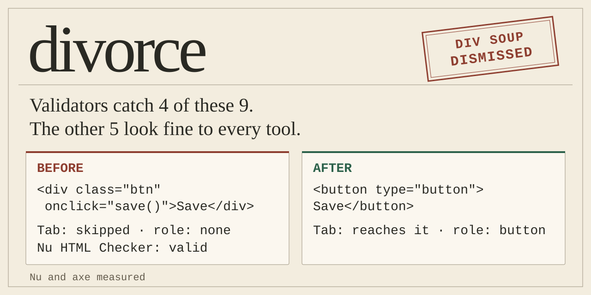
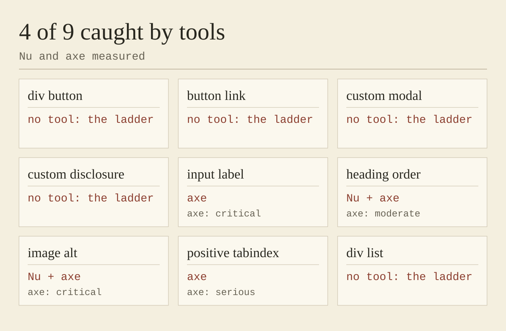
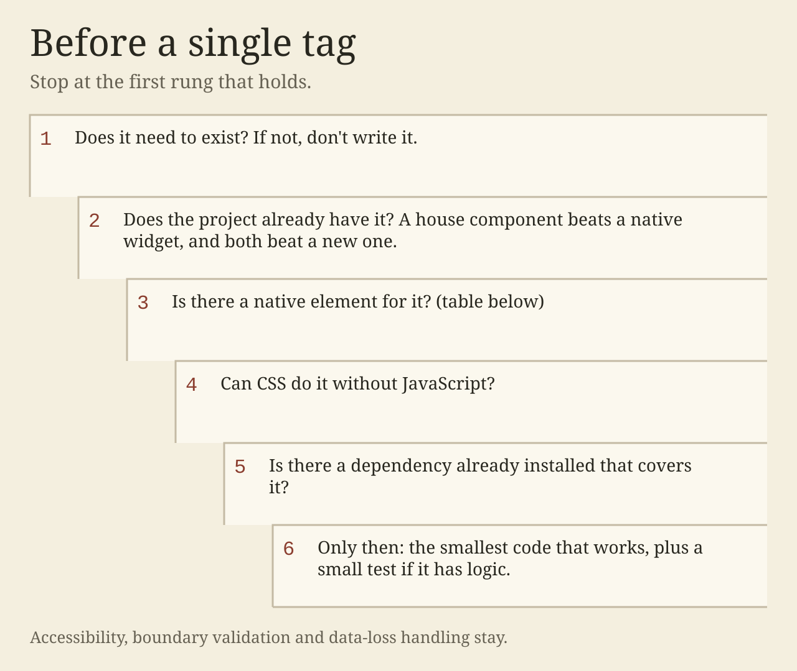
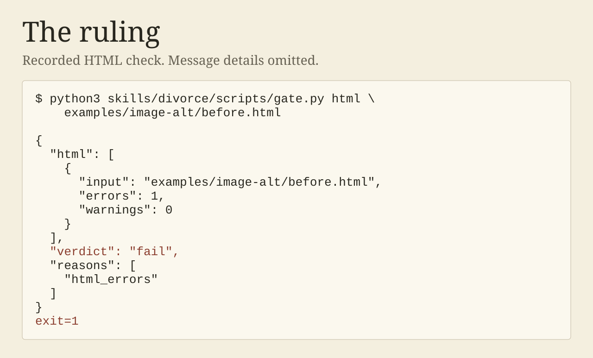

<p align="center">
  <picture>
    <source media="(prefers-color-scheme: dark)" srcset="assets/hero-dark.svg">
    <source media="(prefers-color-scheme: light)" srcset="assets/hero.svg">
    
  </picture>
</p>

**End your agent's toxic relationship with div soup. Write native HTML. Let code deliver the verdict.**

```text
/plugin marketplace add ElRaxy/divorce
/plugin install divorce@divorce
```

Works with Claude Code and Codex · [other agents →](#install)

## Grounds

The petition: too many divs doing a button's job. A `<div onclick>` gets a `role="button" tabindex="0"` patch. A fake select grows out of divs. Then come h1→h3 jumps, inputs without a label, positive tabindex, and an `<a>` without href acting as a button.

divorce is an agent skill that asks what an element does before adding code. Native HTML gets custody of native behavior.

- **The ladder:** omit, reuse, native HTML, CSS, an installed dependency. Only then the minimum JavaScript, plus a small test for logic.
- **The gate:** Nu checks served HTML, axe checks the rendered DOM, and code issues the verdict.
- **`not_measured`:** never counts as a pass.

## The evidence

<p align="center">
  <picture>
    <source media="(prefers-color-scheme: dark)" srcset="assets/cases-dark.svg">
    <source media="(prefers-color-scheme: light)" srcset="assets/cases.svg">
    
  </picture>
</p>

[The case file](examples/manifest.json) and [axe measurements](examples/axe-measured.json): axe-core 4.10.2 in Chrome 156, across all eighteen HTML files. A finding is evidence; its impact and the gate policy determine the ruling.

## Before a single tag

<p align="center">
  <picture>
    <source media="(prefers-color-scheme: dark)" srcset="assets/ladder-dark.svg">
    <source media="(prefers-color-scheme: light)" srcset="assets/ladder.svg">
    
  </picture>
</p>

Read the code, then stop at the first rung that holds. The [skill and its element table](skills/divorce/SKILL.md#2-pick-the-element-by-what-it-does) set the terms; accessibility, boundary validation and data-loss handling remain protected.

## The ruling

<p align="center">
  <picture>
    <source media="(prefers-color-scheme: dark)" srcset="assets/verdict-dark.svg">
    <source media="(prefers-color-scheme: light)" srcset="assets/verdict.svg">
    
  </picture>
</p>

[Recorded output](assets/data/gate-real.json), abbreviated on the card. Nu checks served HTML; axe checks the rendered DOM. Code issues the verdict. Missing or unusable evidence means `not_measured`, never a pass.

## The settlement

Keep the smallest solution that meets the terms. Run both checks on the same page and state; inspect keyboard, focus, interactions and visuals separately. A passing gate closes those checks, not the whole case.

## Fine print

<details>
<summary>With/without: evidence still pending</summary>

The [with/without suite](evals/README.md) compares identical tasks under the same model and run conditions. Results are not published; its model grading is separate from the deterministic gate. No figures are entered into the record until measured.

```sh
claude plugin eval . --ablation with-without --allow-tools Write Edit Bash --no-publish --keep-temp
```
</details>

<details>
<summary>Commands: prepare the evidence</summary>

Shell commands run from the checkout root. Install Nu separately:

```sh
sh skills/divorce/scripts/install-vnu.sh
```

Set `VNU` to the binary path it prints, or put `vnu` on `PATH`. For a JAR installation, use `--jar` and set `VNU_JAR` to the printed JAR path; Java must be available.

With the served version of `examples/div-button/after.html` already loaded in your verification browser session:

```sh
python3 skills/divorce/scripts/gate.py html examples/div-button/after.html
agent-browser eval "$(python3 skills/divorce/scripts/gate.py axe-snippet)" > axe.json
python3 skills/divorce/scripts/gate.py axe axe.json
python3 skills/divorce/scripts/gate.py check --html examples/div-button/after.html --axe axe.json --axe-max-impact serious
```

For your project, replace the HTML input with its served URL or built HTML file. Capture genuine axe evidence from that same page and state. Outside the checkout, use your installed skill's script path. Browser automation is separate: the gate does not open a page, run axe itself or refresh a capture.

See [all commands and flags](docs/how-it-works.md#commands).
</details>

<details>
<summary>Exit codes and verdict: the fine print</summary>

| Exit | JSON verdict | Meaning |
| --- | --- | --- |
| 0 | `pass` | The invoked check passed its configured policy. |
| 1 | `fail` | HTML errors or axe violations at or above the impact threshold. |
| 2 | `not_measured` | Missing tools, unavailable input or unusable evidence. Never a pass. |

[gate.py](skills/divorce/scripts/gate.py) parses Nu's JSON messages and axe's violations. Missing or invalid measurement takes priority, even when a failure was also observed. Otherwise, blocking findings fail; with neither condition, the check passes. The model does not choose the verdict.

The JSON retains counts and reasons. axe totals count violated rules; each rule also records affected nodes. The snippet selects WCAG 2.2 A/AA tags, including earlier versions, plus best-practice rules. Serious and critical violations fail by default; lower-impact findings remain visible. HTML warnings do not fail the check.

A complete gate needs both HTML and axe evidence. An HTML-only pass does not establish an axe pass. The caller must supply genuine evidence for the intended page; the gate does not authenticate it or prove it is current. See [exact reasons and evidence limits](docs/how-it-works.md).

This is not a component library, CSS validator, JavaScript correctness check, performance audit or design review. It does not prove full WCAG conformance or enforce every ladder decision. Manual keyboard, focus, interaction and visual checks remain necessary.
</details>

<details>
<summary>Requirements</summary>

- Python 3.9+ for the standalone installer; Python 3 for the gate.
- A shell for the installation scripts.
- Nu HTML Checker: `VNU`, `vnu` on `PATH`, or `VNU_JAR` with Java.
- For Nu setup: network access, `curl`, and `shasum` or `sha1sum`. Native macOS/Linux archives also need `unzip`; `--jar` needs Java. The installer verifies the downloaded SHA-1 and checks the validator's version command.
- A rendered browser page and a way to evaluate the axe snippet. It loads axe-core 4.10.2 from a CDN unless that version is already present. Script loading must be allowed.
</details>

<details id="install">
<summary>Install: Codex, standalone Claude and other agents</summary>

Choose one route. Run shell commands from an existing checkout's root. For the Claude Code plugin, use the commands at the top; names come from the [plugin](.claude-plugin/plugin.json) and [marketplace](.claude-plugin/marketplace.json) manifests. Validator setup is separate.

| Route | Command | Destination or effect |
| --- | --- | --- |
| Claude, user-wide | `sh install.sh --claude` | Copies the entire skill and scripts to `~/.claude/skills/divorce/`, recording the installation. |
| Claude, one project | `sh install.sh --claude --project DIR` | Copies to `DIR/.claude/skills/divorce/`. |
| Codex | `sh install.sh --codex` | Copies to `~/.codex/skills/divorce/`. `--project` is Claude-only. |
| Other agents | `sh install.sh --agents-md AGENTS.md` | Appends or replaces a marked block in the instruction file your agent reads. |

For a manual copy, copy the entire `skills/divorce/` directory, including scripts, to `~/.claude/skills/divorce/`. Instruction blocks point to the gate's absolute path in the checkout: keep the checkout in place.

The standalone installer does not register a plugin, install validators or add an automatic gate hook. Copies do not update themselves. See [update, dry-run and removal behavior](docs/faq.md#does-installing-it-make-the-gate-run-itself).
</details>

<details>
<summary>FAQ: terms of separation</summary>

- [Framework support](docs/faq.md#can-react-vue-wordpresselementor-and-php-keep-the-house): check served HTML and the rendered DOM.
- [Automated coverage](docs/faq.md#does-a-green-result-mean-wcag-and-i-are-married-forever): a passing gate is not full WCAG conformance.
- [Source versus served HTML](docs/faq.md#why-check-the-served-html-instead-of-the-family-source-tree): validate output, not unrendered templates.
- [Spec versus convention](docs/faq.md#spec-or-convention-who-gets-the-cursor): cite the spec and preserve project conventions.
- [Installation and maintenance](docs/faq.md#does-installing-it-make-the-gate-run-itself): no automatic hook.
- [Not measured](docs/faq.md#can-not-measured-sign-the-pass-papers): never a pass.

[Full FAQ](docs/faq.md) · [Contributing](CONTRIBUTING.md) · [Changelog](CHANGELOG.md)
</details>

<details>
<summary>Credits and license</summary>

### Credits

A cousin of [ponytail](https://github.com/DietrichGebert/ponytail) (MIT), which removes code. divorce guides the code that remains toward the spec. The decision ladder is adapted from ponytail; semantic HTML and modern CSS guidance is adapted from [kemiljk/skills](https://github.com/kemiljk/skills) (MIT).

Nu HTML Checker comes from validator/validator (MIT). axe-core is MPL-2.0. Neither validator is bundled here. See [NOTICE](NOTICE) for attribution and component details.

### License

[MIT](LICENSE). Third-party components retain their own licenses as described in [NOTICE](NOTICE).
</details>
